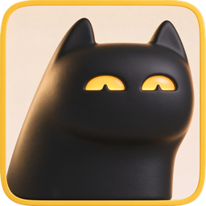
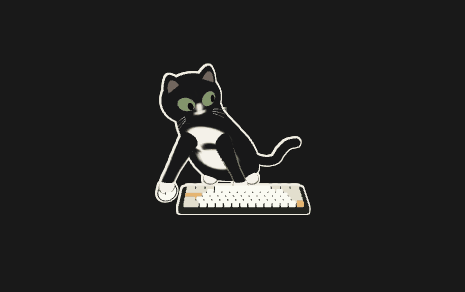
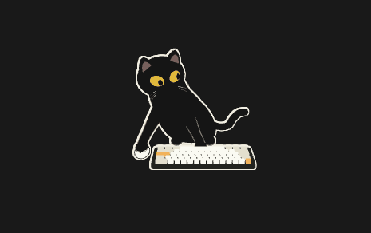
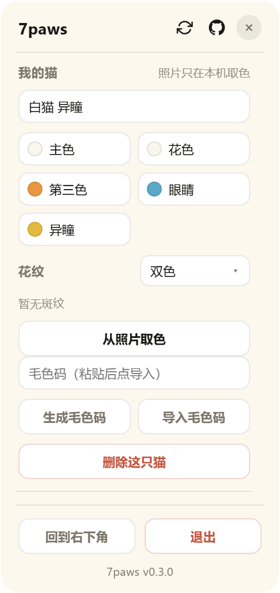
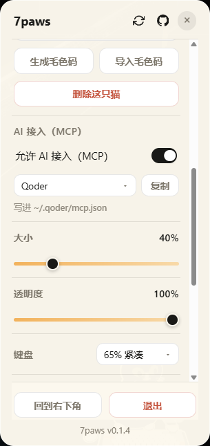
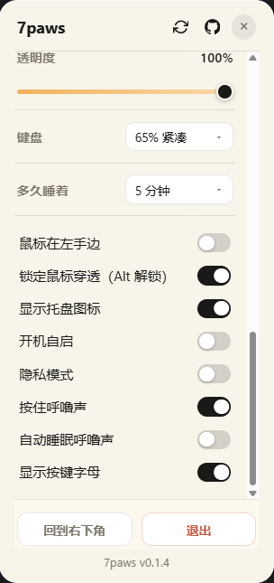

<div align="center">
  
  <h1>7paws</h1>
  <p>Windows 与 macOS 的 3D 桌面小猫桌宠<br>全局键鼠响应 · 照片或 AI 定制专属猫咪 · 摸猫呼噜 · 点击穿透</p>
  <p><a href="https://github.com/7wdn/7paws">GitHub</a> &nbsp;|&nbsp; <a href="https://github.com/7wdn/7paws/releases">下载</a> &nbsp;|&nbsp; <a href="https://github.com/7wdn/7paws/issues">反馈</a></p>
</div>

<div align="center">
  <a href="https://github.com/7wdn/7paws/releases"></a>
  <a href="https://github.com/7wdn/7paws"></a>
  <a href="LICENSE"></a>
  <a href="https://github.com/7wdn/7paws/actions/workflows/ci.yml"></a>
</div>

<div align="center">
  <table>
    <tr>
      <td align="center">
        <br />
        <sub>大咪</sub>
      </td>
      <td align="center">
        <br />
        <sub>面面</sub>
      </td>
    </tr>
  </table>
</div>

## 目录

- [功能特性](#功能特性)
- [下载安装](#下载安装)
- [macOS 首次打开](#macos-首次打开)
- [Windows 安装](#windows-安装)
- [使用](#使用)
- [AI 助手接入（MCP）](#ai-助手接入mcp)
- [默认设置](#默认设置)
- [技术栈](#技术栈)
- [从源码构建](#从源码构建)
- [项目结构](#项目结构)
- [浏览器预览](#浏览器预览)
- [隐私与安全](#隐私与安全)
- [当前范围](#当前范围)
- [发布](#发布)
- [贡献者](#贡献者)
- [开源协议](#开源协议)

## 功能特性

### 互动

- **全局键鼠响应** — 不需要窗口焦点，在任何应用里打字或移动鼠标都会触发动作。
- **滚轮反应** — 滚动鼠标滚轮时，桌面小鼠标跟着滚动，中间按键缝闪一下当前毛色的眼睛色。
- **定时语音提醒** — 设置里可按分钟间隔开启语音提醒，到点用系统本地语音朗读自定义内容，提醒后自动重新计时；提醒内容留空时跳过朗读。
- **3D 小猫** — 圆润的程序化模型，提供十三种毛色；可以新建任意多只「我的猫」，用自家猫咪的照片取色、手调色槽（含异瞳）和花纹，或直接让 AI 通过内置 MCP 生成配色与斑纹；会敲键、看光标、伸爪够鼠标，闲置后睡觉。
- **闲置自由动作** — 短暂无操作后随机舔爪、舔毛、揣手或蜷缩，也会伸懒腰、打哈欠和甩尾巴；动作平滑衔接，按键、鼠标、摸猫或拖拽时立即结束，可在设置里关闭。
- **摸猫与拖拽** — 按住猫头是摸猫，按住身体拖动窗口；猫头判定由渲染器射线检测。
- **呼噜声** — 内置呼噜录音，WebAudio 循环播放并平滑淡入淡出；按住呼噜和睡眠呼噜可独立开关。

### 桌面

- **点击穿透与始终置顶** — 透明区域不影响桌面操作；需要完全不挡鼠标时可在设置菜单或托盘里锁定穿透，按住 `Alt` 临时恢复鼠标操作。不想压在其他窗口上时可以关闭始终置顶。托盘或菜单栏图标可显示、隐藏小猫。
- **全屏游戏置顶守卫** — Windows 10/11 无边框或全屏优化模式下持续恢复小猫置顶，不抢游戏焦点；独占式全屏和反作弊游戏不保证覆盖。关闭始终置顶后守卫不再生效。
- **macOS 多屏与桌面** — 不同缩放倍率的显示器之间拖动小猫后，仍可点击、摸猫和继续拖动；小猫与设置窗口在所有 Spaces 中显示，切换桌面或进入全屏应用时无需重新打开。
- **65% / 104 键盘** — 同一个安装包内运行时切换，默认 65% 紧凑布局。
- **隐私模式** — 只保留左右手动作提示，不显示具体按键。
- **设置持久化** — 毛色、大小、布局、睡眠时间和各项开关保存到本地。
- **检查更新** — 设置窗口右上角点一次，与 GitHub 最新 Release 对比版本，有新版时引导到发布页。

## 下载安装

安装包发布在 [GitHub Releases](https://github.com/7wdn/7paws/releases)。

| 平台 | 安装包 | 说明 |
| --- | --- | --- |
| Windows x64 | `*-x64-setup.exe` | Windows 10/11 x64 |
| Windows ARM64 | `*-arm64-setup.exe` | Windows ARM64；安装器为 x86，应用为原生 ARM64 |
| Windows x64 便携版 | `*-x64-portable.zip` | 解压后双击运行，无需安装；需要系统已安装 WebView2 Runtime |
| Windows ARM64 便携版 | `*-arm64-portable.zip` | 同上 |
| Windows 7 SP1 x64 兼容便携版 | `*-win7-x64-portable.zip` | 非官方兼容构建；内置 WebView2 109 固定运行时，解压后本地运行 |
| macOS Intel | `*-x64.dmg` | Intel Mac |
| macOS Apple Silicon | `*-aarch64.dmg` | Apple Silicon |

每个 Release 附带 `SHA256SUMS.txt`，正文是该版本的更新日志。Windows 安装器跟随系统语言，内置简体中文和英文。历史改动见 [CHANGELOG.md](CHANGELOG.md)。

当前发布包未签名、未公证。macOS 首次打开可能需要手动放行；Windows 未签名安装包可能触发 SmartScreen。

## macOS 首次打开

把对应架构的 `7paws.app` 拖入「应用程序」后：

- 如果提示「无法验证开发者」或「已损坏」，在终端执行：

```bash
xattr -cr /Applications/7paws.app
```

- 打开「系统设置 → 隐私与安全性」，在 **辅助功能**（macOS 26/27 显示为「设备控制与数据访问」）和 **输入监控** 中勾选 7paws，然后完全退出应用再重新打开。
- 只需要这两项权限，没有第三处。
- Apple Silicon 使用 `aarch64` 包，Intel 使用 `x64` 包；不要在 DMG 或下载目录里直接运行。

如果勾选后提示仍在：

1. 从菜单栏彻底退出 7paws，确认没有残留进程；
2. 确认应用位于 `/Applications`，且架构与机器一致；
3. 清除隔离属性和旧授权：

```bash
xattr -cr /Applications/7paws.app
tccutil reset All com.qoder.7paws
```

4. 在「辅助功能」和「输入监控」中用 **+** 重新添加 `/Applications/7paws.app`，打开两个开关；完全退出后重新启动。
5. macOS 26/27 上如果开关已经打开、但启动时仍弹出「7paws 想控制此 Mac 并访问你的数据」：先把两个开关关掉再打开，让系统把授权重新绑定到当前构建，然后完全退出并重新启动。发布包使用 ad-hoc 签名，授权绑定到具体构建，升级后可能需要重新确认一次。
6. 如果仍然无效，正式分发需要 Developer ID 签名与公证。

## Windows 安装

- 需要 Microsoft Edge WebView2 Runtime；安装包内置引导程序，安装时会自动尝试补齐。
- 如果提示 **Could not find the WebView2 Runtime**，常见于 Windows 10 LTSC、精简版或移除了 Edge 的系统。可安装微软官方的 [Evergreen Runtime](https://developer.microsoft.com/microsoft-edge/webview2/)，安装后重新打开 7paws。离线环境请先在有网络的机器下载安装程序，再拷贝到目标机器。
- 未签名安装包可能显示「未知发布者」；确认文件来自本仓库的 Releases 后，可以选择「更多信息 → 仍要运行」。
- Windows ARM64 版需要 ARM64 WebView2 Runtime，安装包会自动尝试安装。
- Windows 便携版可在设置页创建桌面快捷方式；快捷方式指向当前 `7paws.exe`，不会复制文件或运行时。NSIS 安装版不显示该入口。
- Windows 7 SP1 x64 兼容版的安装与限制见下文。

## 全屏游戏

- Windows 10/11 会持续检查小猫的 topmost 状态和前台窗口 Z 序；被无边框或全屏优化游戏盖住时，自动恢复置顶且不抢焦点。
- 设置窗口打开、拖拽小猫或隐藏小猫时暂停守卫。
- 如果游戏本身以管理员权限运行，可在设置页选择「以管理员身份重启」。此操作不会自动提权，需要你确认 UAC。
- 可开启「默认以管理员身份运行」，下次启动时按需请求 UAC；已经提权时不会循环提示。默认关闭，开机自启也可能因此弹出 UAC。
- 独占式全屏、使用内核反作弊的游戏可能禁止其他窗口覆盖；建议使用无边框窗口化，必要时暂停或隐藏小猫。

## Windows 7 兼容版

- 仅提供 **Windows 7 SP1 x64** 非官方兼容便携包 `*-win7-x64-portable.zip`，不支持 x86 和 Windows 8。
- 解压全部文件，保持 `7paws.exe` 与 `WebView2Runtime` 同级，并从本地磁盘运行；不要从 UNC 或网络路径运行。
- 内置 WebView2 **109.0.1518.78** 固定运行时，不自动更新；正常 Windows 10/11 包仍使用系统 Evergreen Runtime。
- 小猫通过原生分层窗口呈现，帧率约 30fps，帧缓冲与窗口物理尺寸对齐；设置窗口使用不透明背景，不显示任务栏图标。
- Windows 7 和 Runtime 109 均已停止安全维护，兼容包不代表官方或安全支持。

## 使用

- 右键小猫打开设置窗口，窗口出现在猫的旁边，可拖动标题栏移动；点外部、按 `Esc` 或右上角关闭。
- 按住猫头是摸猫；按住身体拖动窗口。
- 托盘图标（macOS 为菜单栏图标）左键显示或隐藏小猫；菜单可切换锁定鼠标穿透、打开设置或退出。
- 设置菜单可切换毛色（含「我的猫」：新建、照片取色、毛色码导入导出、给两只眼睛分别配色的异瞳色槽，命名多只随意切换）、键盘布局、睡眠时间、鼠标左右手、始终置顶、锁定鼠标穿透、托盘图标、开机自启、隐私模式、呼噜开关、按键字母和定时语音提醒。
- 锁定鼠标穿透后整窗不接收鼠标操作，按住 `Alt` 可临时拖动或右键打开菜单。
- 大小滑杆拖动时只预览百分比，松手后应用。
- 设置窗口右上角可以检查更新、打开 GitHub 仓库，底部显示当前版本。

### 设置界面

<div align="center">
  <table>
    <tr>
      <td align="center">
        <br />
        <sub>我的猫：异瞳色槽、花纹与斑纹</sub>
      </td>
      <td align="center">
        <br />
        <sub>毛色码与 AI 接入（MCP）</sub>
      </td>
      <td align="center">
        <br />
        <sub>透明度、睡眠与各项开关</sub>
      </td>
    </tr>
  </table>
</div>

## AI 助手接入（MCP）

7paws 内置一个不依赖 Node/Python 的 stdio MCP 服务。照片由你发给 AI 客户端，AI 读取后生成配色、花纹和斑纹，运行中的小猫约 1 秒内热更新，无需重启。

### 配置

1. 右键小猫打开设置，找到「AI 接入（MCP）」，确认开关已打开。
2. 在客户端下拉里选择你用的 AI 工具（Qoder 优先，共 15 个：Claude Code、Cursor、CodeBuddy、ZCode、TRAE、VS Code、Windsurf、Codex、DeepSeek Harness、OpenCode、Pi、Cherry Studio、WorkBuddy、Antigravity）。
3. 点「复制」，把生成的配置粘贴到下拉下方提示的文件（如 `~/.qoder/mcp.json`）或客户端设置页，然后重载 MCP 配置或重启客户端。

通用的 stdio 配置形如（`command` 指向 7paws 程序路径，也可以用 `~/.7paws-mcp/7paws.exe` 这类固定副本，避免开发时占用安装/构建目录）：

```json
{
  "mcpServers": {
    "7paws": {
      "command": "安装目录\\7paws.exe",
      "args": ["--mcp"]
    }
  }
}
```

### 工具

| 工具 | 作用 |
| --- | --- |
| `get_cat_schema` | 配色语义、四种花纹、斑纹坐标与模板；AI 通常会先读它 |
| `list_cats` | 列出内置与自定义猫，标出当前激活的猫 |
| `upsert_cat` | 创建或覆盖一只猫（毛色、花纹、斑纹），可立即切换 |
| `switch_cat` | 按 id 切换当前小猫 |
| `delete_cat` | 删除一只自定义猫 |

### 对 AI 这么说

把照片直接拖进对话，或者只用文字描述，例如：

- 「用 7paws MCP 按这张照片给我捏一只猫：先读 schema，再按照片选毛色、花纹和斑纹，用新的 id，做完切过去。」
- 「它额头有一道深色竖纹、胸口是白的、背上有一大块橘色，把这三处写进 spots。」
- 「刚才那只猫的白胸口往上挪一点、再放大一圈。」
- 「把当前这只改成三花：奶白底，橘色和黑色斑块，眼睛换成琥珀色。」
- 「它有异瞳：一只眼睛蓝色、一只琥珀色。」
- 「列出我所有的猫，然后切回奶牛猫。」
- 「这只不像，删掉它。」

斑纹由 AI 按 schema 里的 uv 坐标摆放，第一版位置可能有偏差；直接告诉它往哪边挪、放大还是缩小，它会改坐标重新应用，每次约 1 秒上屏。

### 说明

- 斑纹（spots）目前只支持头部和身体（每只最多 24 处），四肢和尾巴暂不支持；坐标 0.25 为正面中心、0.75 为背面，schema 内附额头纹、眼罩、白胸口、背部色块模板。
- 关闭「允许 AI 接入（MCP）」后，工具调用会返回明确提示；重新打开即可恢复，无需重启客户端。
- 自定义猫保存在配置文件同目录的 `cats.json`，应用运行时轮询文件变化并热更新；设置窗口里也能给「我的猫」生成毛色码，复制分享或粘贴导入。
- 照片只发给 AI 客户端；除用户主动点击「检查更新」时读取 GitHub 版本号外，7paws 本身没有任何网络请求。
- 升级安装时，安装器会通过 Windows Restart Manager 检测占用（包括 AI 客户端拉起的 `--mcp` 进程）并提示关闭后继续；完成后重启 AI 客户端即可恢复 MCP。若 AI 客户端以管理员身份运行，需要先手动退出它再升级。

## 默认设置

| 设置 | 默认值 |
| --- | --- |
| 大小 | 60%（可调 10%–150%） |
| 透明度 | 100%（可调 10%–100%） |
| 键盘布局 | 65% 紧凑 |
| 毛色 | 奶牛猫 |
| 我的猫 | 无（设置里点「＋ 新建」，或让 AI 通过 MCP 创建） |
| 睡眠时间 | 5 分钟 |
| 闲置自由动作 | 开启 |
| 按住呼噜声 | 开启 |
| 自动睡眠呼噜声 | 关闭 |
| 显示按键字母 | 开启 |
| 定时语音提醒 | 关闭 |
| 提醒内容 | 空 |
| 提醒间隔 | 30 分钟（可调 1–1440） |
| 始终置顶 | 开启 |
| 显示托盘图标 | 开启 |
| 允许 AI 接入（MCP） | 开启 |
| 开机自启 | 关闭 |
| 默认以管理员身份运行 | 关闭 |
| 鼠标在左手边 | 关闭 |
| 锁定鼠标穿透 | 关闭 |
| 隐私模式 | 关闭 |

配置文件位置：

- Windows：`%APPDATA%\7paws\settings.json`
- macOS：`~/Library/Application Support/7paws/settings.json`

macOS 的开机自启通过 `~/Library/LaunchAgents/com.qoder.7paws.plist` 注册。

## 技术栈

- **桌面壳** — Tauri 2 + Rust；全局键鼠钩子、窗口、托盘、点击穿透和设置持久化。
- **前端** — TypeScript + Vite，无 UI 框架；three.js + WebGL 渲染 3D 小猫。
- **输入** — Windows 低级键鼠钩子；macOS CGEventTap（辅助功能 + 输入监控）。
- **音频** — WebAudio 播放内置呼噜录音，无网络音频资源；没有网络请求、账号或遥测。

## 从源码构建

```bash
pnpm install
pnpm build
pnpm tauri:dev
```

安装包：

```bash
# Windows x64 NSIS
pnpm tauri:build

# macOS Intel / Apple Silicon
pnpm tauri build --target x86_64-apple-darwin
pnpm tauri build --target aarch64-apple-darwin

# Windows ARM64（在 Windows 上交叉编译）
pnpm tauri build --target aarch64-pc-windows-msvc --bundles nsis

# Windows 7 SP1 x64 兼容构建（独立 target-win7，不改正常包）
pnpm tauri:win7
pnpm verify:win7
```

macOS 安装包必须在 macOS 上构建，Tauri 不支持从 Windows 交叉编译。按架构构建的产物位于 `src-tauri/target/<target>/release/bundle/`。

Rust 代码检查：

```bash
cd src-tauri
cargo check
```

## 项目结构

```text
.
├─ .github/workflows/   CI、手动构建与 tag 发布
├─ src/                 前端入口、适配层、毛色、音频与样式
├─ public/vendor/       three.js 与 3D 渲染器
├─ public/audio/        内置呼噜录音
├─ src-tauri/           Tauri 窗口、全局输入、设置、托盘与平台配置
├─ assets/              应用图标源、备选图标与 README logo
├─ index.html           小猫窗口骨架与启动错误提示
├─ settings.html        独立设置窗口
├─ LICENSE              MIT 许可证
└─ README.md
```

## 浏览器预览

```bash
pnpm dev
```

浏览器预览没有 Tauri 全局钩子和原生窗口，键鼠动作不会触发全局响应，设置只保存在内存中。右键小猫会在新窗口打开设置页，也可直接访问 `settings.html`。可用参数：

- `?demo=1`：自动输入演示。
- `?localinput`：捕获当前窗口内的键盘与滚轮事件。
- `?previewCoat=tuxedo`：预览指定毛色，可选 `tuxedo`、`orange`、`tabby`、`calico`、`siamese`、`black`、`white`、`blue`、`gray-white`、`orange-white`、`tortie`、`cream`、`silver`。

## 隐私与安全

- 7paws 读取全局键盘和鼠标输入只是为了驱动小猫动作；不记录、不保存、不上传按键内容。
- 隐私模式只发送左右手动作提示，不显示具体按键。
- 设置只写入本地文件；没有账号、遥测或分析。唯一的联网行为是用户在设置窗口点击「检查更新」时访问 GitHub Releases API：只读取最新版本号，不发送任何本地数据，也不自动检查。
- 配置路径：Windows 为 `%APPDATA%\7paws\settings.json`，macOS 为 `~/Library/Application Support/7paws/settings.json`。

## 当前范围

- 正式支持 Windows 10/11 x64 与 ARM64，macOS 10.15+ Intel 与 Apple Silicon。
- Windows 7 SP1 x64 提供非官方兼容便携版；Windows 8 与 Linux 暂未支持，后续版本优先考虑 X11 会话。
- macOS 以菜单栏图标驻留，不显示 Dock 图标。
- 发布包目前未签名；macOS 26/27 上如果权限无法保持，需要 Developer ID 签名与公证。
- 104 布局按标准全键盘排列，包含 F 区、导航区、方向键和小键盘。

## 发布

1. 同步 `package.json`、`package-lock.json`、`src-tauri/tauri.conf.json`、`src-tauri/Cargo.toml` 与 `src-tauri/Cargo.lock` 的版本号。
2. 推送 `vX.Y.Z` tag。
3. GitHub Actions 的 Release 工作流构建 Windows x64/ARM64 NSIS 与 macOS Intel/Apple Silicon DMG，并发布 Release，附 `SHA256SUMS.txt`。

发版只走 tag 触发的一次构建；不要先手动运行 “Build bundles” 再打 tag。手动构建工作流只用于排障。

## 贡献者

<a href="https://github.com/7wdn/7paws/graphs/contributors">
  
</a>

## 开源协议

[MIT](LICENSE)
